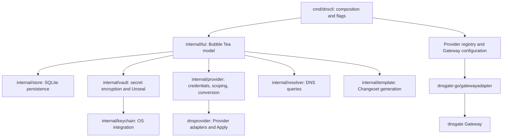
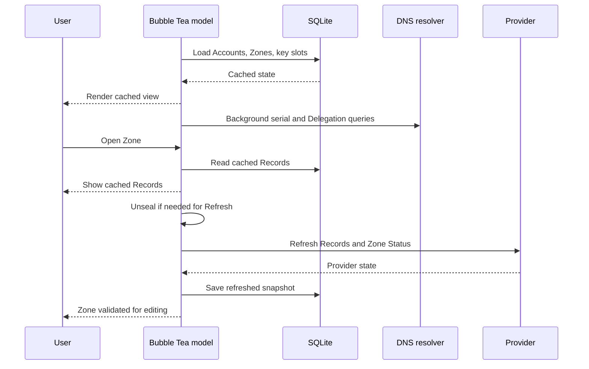

# Architecture

dnscli is a Go terminal application for browsing and managing DNS hosting across multiple Providers and Accounts. It uses a local SQLite database for immediate access to cached data, a Bubble Tea model to coordinate interactive work, and Provider adapters for remote operations.

This document describes the implemented design: component boundaries, the domain model, cache and credential storage, background work, and the safeguards around remote changes. The [architecture decisions](adr/) explain the choices and tradeoffs behind it; the final section records where the implementation has evolved beyond those decisions. Domain terminology follows [GLOSSARY.md](../GLOSSARY.md).

## Scope and design principles

The application manages hosted Zones, Records, supported Zone settings, and DNSSEC workflows. It can start and stop DNS hosting where a Provider supports those operations. Domain purchases, renewals, WHOIS, and registration transfers remain out of scope.

The design has four central rules:

1. Opening the cached view never waits for a Provider or for Unseal.
2. DNS observations and Provider state serve different purposes. A matching SOA serial is a freshness hint; a successful Provider Refresh validates a Zone for editing.
3. Remote success determines what was applied. The cache reflects confirmed results immediately, including partial success.
4. Background work returns messages to the Bubble Tea update loop. It never mutates UI state directly.

## Components and dependencies

| Component | Responsibility |
| --- | --- |
| [`cmd/dnscli`](../cmd/dnscli/main.go) | Parse flags and environment, open the database, assemble dependencies, start the alternate-screen TUI, and cancel the session on exit. |
| [`internal/tui`](../internal/tui/model.go) | Own navigation, dialogs, session state, background queues, pending Changesets, and operation coordination. Render with Lip Gloss. |
| [`internal/dns`](../internal/dns/dns.go) | Define local Account, Zone, Record, Changeset, and DNSSEC observation types. |
| [`internal/provider`](../internal/provider/open.go) | Decode credentials, construct Providers, resolve Tenant scope, memoize discovery, and convert local and Provider types. |
| [`internal/store`](../internal/store/store.go) | Persist Accounts, encrypted secrets, key slots, cached Zones and Records, and DNSSEC timing observations. |
| [`internal/vault`](../internal/vault/vault.go) | Encrypt Account credentials and wrap the shared data key through independently enrolled Unseal Methods. |
| [`internal/keychain`](../internal/keychain/keychain.go) | Supply the platform-specific Keychain backend. |
| [`internal/resolver`](../internal/resolver/system.go) | Query recursive and authoritative DNS for serials, Delegation, DS, and signing keys. |
| [`internal/template`](../internal/template/template.go) | Produce Changesets from typed parameters and existing Records without performing I/O. |

Provider API implementations belong to the external `github.com/dnsgateway/dnsprovider` module. The Gateway Adapter comes from `github.com/dnsgateway/dnsgate-go/gatewayadapter` and implements the same interface. The current module declares Go 1.27.

## Domain model

An **Account** is a named set of credentials at a Provider, displayed as `<provider>.<account>`. A **Tenant** is the scope those credentials act within. Credentials may reach several Tenants; an Account can retain a selected Tenant for operations that need one.

A **Zone** is identified locally by `(Account, zone name)`. The same name can exist in several Accounts, including a hosting Account and a registrar Account. Local database IDs and opaque Provider IDs are separate. Records preserve Provider IDs and additional fields such as Cloudflare's proxy setting.

A **Changeset** contains additions, modifications, and deletions for one Zone. Modifications and deletions retain the original Record in `Before`, which supports conflict checks. The TUI holds pending Changesets in memory and overlays them on cached Records for display; pending changes are not persisted as a durable job queue.

The **Live Zone** is the copy whose expected nameservers match the publicly resolved Delegation, compared as normalized sets. Its identity is unknown when either side is unavailable. A **Registration** is a copy held by an Account verified to register that name; it can be used for DS writes when its Provider is a Registrar Adapter.

## Startup and session state

[`Model.Init`](../internal/tui/model.go) loads Accounts, Zones, and key slots from SQLite without network access. Opening a Zone reads its cached Records first. After loading the cache, the model schedules Serial Checks and Delegation lookups in the background. Access to Provider credentials goes through Unseal; browsing cached data requires no secret.

Freshness hints, successful validation, pending work, lookup results, and the released data key are session state. No Zone starts validated merely because its database entry has a recent refresh timestamp. A failed later Refresh removes validation; cached Records remain available.

The UI has Domains and Accounts panes on the left and a larger Records pane on the right. Navigation is represented as actions through a validated Shortcut Profile. Pane-specific search filters the local view, and choosing an Account filters the Zones shown. Forms and confirmation dialogs run through the same model.

## Freshness and Refresh

[`freshness.go`](../internal/tui/freshness.go) compares cached SOA serials with answers from the system resolver. Its states distinguish unknown, checking, matching, different, and failed checks. These are hints because recursive caches can lag and public Delegation may point at another Account's copy of a Zone. A serial match never permits editing, and a mismatch does not automatically fetch every Record.

[`refresh.go`](../internal/tui/refresh.go) reads Records through the Provider API. It reads Zone Status and queries the Zone's nameservers for a serial alongside the Record request. The Provider's reported serial takes precedence; an authoritative SOA answer supplies a fallback, and an unavailable serial leaves the cached value intact.

Records, refresh time, and associated cache updates are saved transactionally. A failed Zone Status read preserves the previous status and reports that it is older; it does not fail an otherwise successful Record Refresh. A status read has a ten-second timeout, and an authoritative serial query has a five-second timeout with a five-minute backoff after failure.

For direct DNS queries, Provider-assigned nameservers take precedence. Public Delegation is a fallback only when the zone name is not shared across Accounts, avoiding queries to another copy's nameservers.

Zones whose Provider reports that it serves no Records are treated as registration only. They can remain visible without allowing Record edits that would have no effect.

## Record editing and Apply

The [`write gate`](../internal/tui/changeset.go) requires an unsealed session, a successful Refresh in the current session, no pending Refresh, and no Apply in flight for the Zone. Registration-only Zones are refused. Editing a pending Changeset and applying it both pass through this gate.

The user previews the Changeset before Apply. [`apply.go`](../internal/tui/apply.go) converts it to Provider types and calls `dnsprovider.Apply`, which rechecks the Records the Changeset was built from before sending changes.

| Outcome | Behavior |
| --- | --- |
| Original Records changed remotely | Send no changes, show conflicts, Refresh the Zone, and retain pending changes for review. An explicit apply-over action rebases conflicting changes onto the current Records. |
| All changes succeed | Cache the confirmed Records immediately and remove them from the pending Changeset. |
| Some changes fail | Cache confirmed changes, retain failed changes, and show individual outcomes. |
| Provider confirms changes but cache persistence fails | Report the remote result, remove validation, and require a Refresh before another edit. |
| A returned Record cannot be cached because its Provider ID is missing | Require Refresh to recover a complete cached representation. |

A Changeset is a user-visible operation, but remote application can have per-change results; it is not a distributed transaction with rollback across the Provider and SQLite. Provider adapters own API success semantics.

The UI does not wait for SOA propagation after success. If the Provider returns no serial, background polls query authoritative nameservers at elapsed times of five, fifteen, and forty-five seconds. Serial comparison uses RFC 1982 arithmetic to handle wraparound.

## Providers, Tenants, and the Gateway

The Provider registry supplies factories and credential-field descriptions. The TUI uses those descriptions for Account forms and Provider traits for available actions, TTL ranges, automatic TTL, and proxy support. Provider-specific settings still exist where needed, particularly Cloudflare's HSTS and minimum TLS version.

The [`Opener`](../internal/provider/open.go) keeps credential interpretation and Tenant discovery out of individual workflows. It automatically scopes credentials that reach one Tenant and requests a choice when several are available. Tenant and Account-nameserver discovery are memoized by credentials and coordinated across concurrent calls. Zone discovery can use an unscoped Provider to list all reachable Tenants while onboarding uses the Account's own selected Tenant.

The `dnsgate` Account stores a Gateway address and Gateway-issued token. DNS hosting credentials stay at the Gateway. [`gateway.go`](../cmd/dnscli/gateway.go) registers this adapter and adds optional PEM CA files to system trust through repeated `--ca-file` flags or the `DNSCLI_CA_FILE` path list.

## Persistence and credentials

[`internal/store`](../internal/store/migrate.go) uses pure-Go SQLite through `modernc.org/sqlite`. Its main tables are:

| Table | Stored data |
| --- | --- |
| `accounts` | Provider type, Account name, and encrypted credential field map. |
| `zones` | Account association, zone name, Provider ID, SOA serial, refresh time, nameservers, Hosting State, Zone Status and its read time, and DNSSEC timing observations. |
| `records` | Zone association, Provider ID, type, name, value, TTL, and extras as JSON. |
| `key_slots` | Unseal Method, method parameters, and wrapped data key. |

The default path is `dnscli/dnscli.db` under `os.UserConfigDir()` and can be overridden with `--db`. Foreign keys enforce relationships and cascade local deletion. The Store uses one connection, WAL mode, and a five-second busy timeout. Ordered migrations use `PRAGMA user_version`; an immediate write transaction serializes schema changes, and newer unsupported schemas are rejected.

Credentials are encrypted with a random shared data key using XChaCha20-Poly1305. Each ciphertext has a version and random nonce, with an owner label authenticated alongside it to prevent moving a secret between owners. Account metadata and DNS cache contents remain plaintext so the view can render while sealed.

Each enrolled Unseal Method independently wraps the same data key:

- **Passphrase:** Argon2id derives a wrapping key using stored salt and cost parameters. New slots default to three iterations, 64 MiB, and four lanes; stored parameters are bounded before use.
- **Keychain:** a random wrapping key is stored in the OS Keychain behind user authentication; SQLite holds its reference and the wrapped data key. The macOS implementation requires cgo and appropriate signing and entitlements for Touch ID.

`--unseal` selects a session method, followed by `DNSCLI_UNSEAL`, then the platform default: Keychain on macOS when available, otherwise passphrase. Passphrase enrollment and recovery allow operation when Keychain authentication is unavailable. Other platforms currently have no native Keychain backend.

The database is persistent application state, not a disposable cache. Losing it loses Account definitions; losing every usable Unseal Method makes its secrets unrecoverable.

## Zone lifecycle and settings

Account re-listing discovers Zones added or removed outside dnscli and updates cached Hosting State and nameservers. Reloading the local view is separate from fetching Provider Records.

[`Onboarding`](../internal/tui/onboard.go) starts DNS hosting through a capable Provider after confirming the Account, Tenant, and zone name. It shows assigned nameservers and pending state without changing registration or public NS Delegation.

[`Offboarding`](../internal/tui/offboard.go) stops DNS hosting and removes that copy's Records. It refuses the Live Zone and refuses uncertainty about whether deletion is safe. Immediately before deletion, it resolves Delegation again and rereads Provider state, including Tenant ownership. A failed or canceled delete may require a read-back to determine whether the Provider took it.

[`Zone settings`](../internal/tui/zone_edit.go) use Provider capabilities and expose confirmation before remote changes. Supported settings include DNSSEC and, for Cloudflare, HSTS and minimum TLS version. NS Delegation remains read-only.

## DNSSEC and registrar DS writes

DNSSEC coordinates three sources of information: signing state at the hosting Provider, keys served by authoritative nameservers, and DS records served by the parent zone. They are observed separately; an unavailable answer is never interpreted as absence.

[`Key Lookup`](../internal/tui/signing_keys.go) uses the Provider API when possible and otherwise queries the Zone's nameservers, including after an API read fails. Direct lookup requires every queried nameserver to agree on the key-signing keys and verifies the DNSKEY RRset's self-signature. This observation does not establish a complete chain of trust. [`DS Check`](../internal/tui/parent_ds.go) queries the parent's authoritative nameservers directly, retaining both DS contents and TTL.

The workflow derives the next step from these observations:

- **Turn on:** enable signing at the hosting Provider, wait for keys, then wait for the largest cached Record TTL from the first observation of signing before offering DS publication. Publication remains unavailable until Records have been read.
- **Publish or replace DS:** find a Registration through a capable Registrar Adapter and confirm the selected Account and exact replacement set. A mismatching DS can be replaced with the Zone's keys; a stray DS for a Zone with no keys can be removed.
- **Turn off:** remove DS at the registrar first, observe its absence at the parent, wait its last observed TTL, then allow unsigning through the hosting Provider and its write gate. An unknown previous DS TTL uses a conservative 24-hour wait.

[`dnssec_ds_write.go`](../internal/tui/dnssec_ds_write.go) checks registrar capabilities rather than assuming the hosting Account also registers the name. Without a suitable adapter, the UI provides the values and steps for manual registrar changes. Background timers recheck the open Zone while waiting on propagation. Signing observation time, DS absence time, and last DS TTL persist across sessions; active workflow choices and lookup answers do not.

## Templates

Templates generate ordinary pending Changesets, so their results use the same preview, conflict detection, and Apply path as manual edits. Built-ins cover Google mail, Proton mail, and parked domains. Parameters include verification tokens, DKIM values, and DMARC policy and report destinations.

The template engine limits changes to Record sets owned by the selected Template and compares normalized DNS names and values. Singleton sets such as SPF are reconciled explicitly. Mail templates preserve unrelated DMARC tags while updating policy and report addresses, and the UI can warn about weaker policy choices. The parked-domain template also replaces DKIM Records under `_domainkey` with its revocation configuration.

## Concurrency, cancellation, and verification

Bubble Tea commands perform I/O and return typed messages. The update loop owns UI state and advances queues. Default limits are eight concurrent Serial Checks, a separate shared limit of eight Delegation/DS/key lookups, and four Refreshes. A Zone has at most one queued or running Refresh. Refresh, Apply, and Offboarding are coordinated to prevent an older read from replacing newer confirmed state. Provider retry times suppress premature Refresh retries.

Commands capture the dependencies and operation identity they need; handlers discard obsolete results where an operation has been superseded or a Zone removed. A session context and operation-specific contexts support cancellation. Timers stop on quit, and quitting accounts for pending changes and in-flight work.

[`Deps`](../internal/tui/deps.go) injects the Store, Provider registry, Resolver, Clock, timer, Shortcut Profile, and Unseal Methods. The [TUI test harness](../internal/tui/harness_test.go) drives `Update` and commands with fake Providers and DNS answers, controlled time, and a real temporary SQLite database. Package tests also cover persistence, migrations, encryption, DNS queries, and templates. A `fakeprovider` build tag supplies an interactive fake Provider for development.

## ADR alignment and implementation notes

| Decision | Current implementation and refinements |
| --- | --- |
| [ADR-0001: cache-first with a write gate](adr/0001-cache-first-with-write-gate.md) | Cache-first rendering, session-only validation, conflict checks, and immediate caching of confirmed writes. Direct authoritative SOA fallback and post-write polling now supplement the system-resolver hints. |
| [ADR-0002: Bubble Tea](adr/0002-bubble-tea-over-tview.md) | Commands and result messages coordinate background work; the model owns UI state. |
| [ADR-0003: own Provider module](adr/0003-own-provider-module.md) | Provider implementations and Changeset Apply live in the separate `dnsprovider` dependency. Cloudflare was the initial adapter; the application consumes the module's registry and capabilities. |
| [ADR-0004: registration out of scope](adr/0004-no-registration-delegation-read-only.md) | Registration operations and NS writes remain out of scope. ADR-0007 amends the read-only Delegation rule for DS. |
| [ADR-0005: encrypted credentials in SQLite](adr/0005-accounts-encrypted-in-sqlite.md) | Shared data key with independent passphrase and Keychain slots. Provider secrets are encrypted in SQLite rather than stored individually in the OS Keychain. |
| [ADR-0006: externally owned Gateway Adapter](adr/0006-gateway-adapter-from-dnsgate.md) | Adapter ownership remains outside dnscli. The ADR names the earlier `dnsgate` package path; current code imports `dnsgate-go/gatewayadapter`. Go remains 1.27. |
| [ADR-0007: registrar DS writes](adr/0007-ds-writes-at-the-registrar.md) | Capability-based registrar discovery and confirmed exact-set DS writes, with DNSSEC propagation steps. The ADR identifies Porkbun and Gandi as initial adapters rather than Namecheap. |
